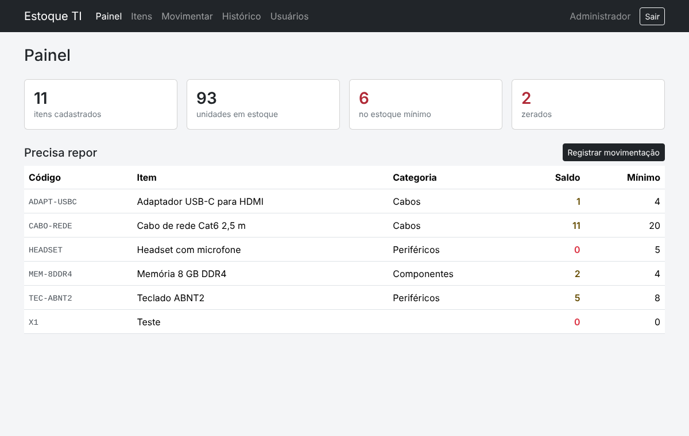
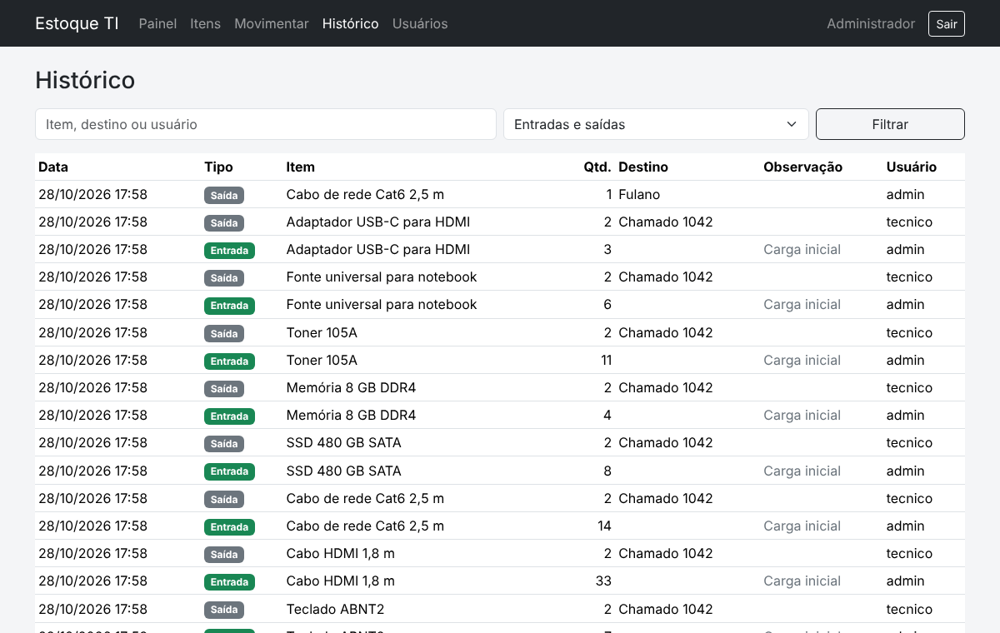

# Estoque TI

Controle de estoque para o almoxarifado de TI: periféricos, cabos, peças e suprimentos.
Registra cada entrada e saída, avisa quando um item chega ao mínimo e mostra quem retirou o quê.

Versão genérica de um sistema que desenvolvi e uso no dia a dia do suporte.



## Funcionalidades

- **Painel** com itens no estoque mínimo e zerados
- **Itens** com código, categoria e estoque mínimo; busca e filtro
- **Movimentação** de entrada e saída; saída exige destino (pessoa, setor ou chamado)
- **Histórico** completo, com filtro por item, destino, usuário e tipo
- **Usuários** com perfis Administrador e Técnico
- O saldo só muda por movimentação, então o histórico sempre fecha com o estoque



## Decisões técnicas

- **Sem banco de dados:** os dados ficam em JSON fora da pasta pública, com `flock` para evitar gravações simultâneas. Roda em qualquer servidor com PHP, sem instalar nada
- Senhas com `password_hash`, proteção CSRF em todo formulário, sessão com `httponly`
- Saída sempre escapada com `htmlspecialchars`
- Regras de negócio em classes (`src/`), telas separadas em `views/`
- Bootstrap local, sem depender de internet (pensado para rede interna)

## Rodando

```bash
php bin/demo.php                 # opcional: cria dados de exemplo
php -S localhost:8000 -t public
```

Sem os dados de exemplo, o primeiro acesso pede para criar o administrador.

Logins da demonstração: `admin` / `admin1234` e `tecnico` / `tecnico1234`.

Em produção, aponte o Apache ou Nginx para a pasta `public/`. A pasta dos dados pode ser trocada pela variável `ESTOQUE_DADOS`.

## Testes

```bash
php tests/run.php
```

Rodam no GitHub Actions a cada push.

## Estrutura

```
public/    ponto de entrada, CSS e Bootstrap
src/       Armazem (JSON), Estoque, Usuarios, funções web
views/     telas
bin/       dados de demonstração
tests/     testes das regras de estoque e usuários
```

## Stack

PHP 8.1+ · Bootstrap 5 · JSON · GitHub Actions
